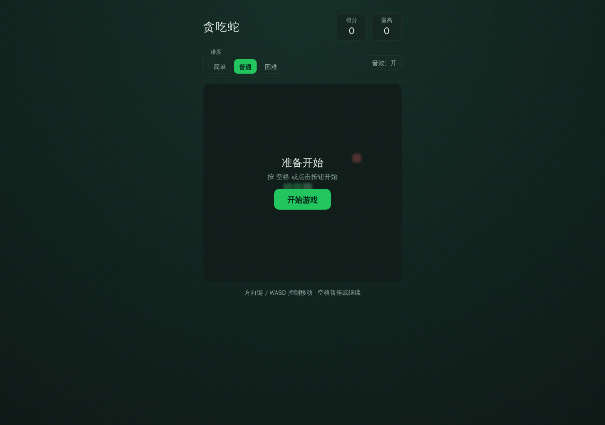

# craft-snake-rebuild · 贪吃蛇交互复刻

[](https://github.com/yyds8170-ctrl/craft-snake-rebuild/actions/workflows/ci.yml)
[](LICENSE)
[](https://github.com/yyds8170-ctrl/craft-snake-rebuild/releases/tag/v1.3.0)
[](#验证与证据)

从零独立实现、可直接在浏览器运行的贪吃蛇交互示例：纯逻辑引擎可单元测试，附难度选择、程序化音效、完美通关判定与端到端测试，用于验证洁净室闭环对带交互逻辑目标的处理能力。

> **维护者 / Maintainer：洋洋（[yyds8170-ctrl](https://github.com/yyds8170-ctrl)）**
>
> 本仓库为独立实现，不包含任何第三方源码或二进制，与相关第三方**无隶属、无背书、无赞助关系**。详见 [NOTICE](NOTICE)。



## 特性亮点

- **三档难度**：简单 / 普通 / 困难，对应不同初始速度、速度下限与加速曲线，引擎层归一化非法难度。
- **完整玩法**：方向键 / WASD 控制，禁止 180° 直接反向；空格暂停 / 继续；吃食物计分，速度随分数递增。
- **完美通关判定**：蛇填满整个网格、无空格可放食物时返回 `won`，界面显示通关。
- **程序化音效**：Web Audio 合成吃食物与结束音效，零外部资源，可一键静音。
- **本地最高分**：`localStorage` 持久化；撞墙 / 撞自身判定，结束后可重开。
- **移动端适配**：虚拟方向键与响应式布局。

## 快速开始

本项目使用 ES module，**请通过本地 HTTP 服务运行**（直接用 file:// 打开会因浏览器 CORS 策略阻止模块加载）：

```bash
git clone https://github.com/yyds8170-ctrl/craft-snake-rebuild.git
cd craft-snake-rebuild
python3 -m http.server 8000
# 浏览器访问 http://localhost:8000
```

## 玩法 / 操作参考

| 操作 | 作用 |
| --- | --- |
| 方向键 / WASD | 控制移动方向（禁止 180° 直接反向） |
| 空格 | 开始 / 暂停 / 继续 |
| 难度按钮 | 简单 / 普通 / 困难切换速度曲线 |
| 音效按钮 | 开启 / 静音程序化音效 |
| 移动端方向键 | 触屏转向 |

## 验证与证据

- **单元测试（18 项）**：对纯逻辑引擎 `js/engine.js` 验证移动、吃食物、碰撞、方向、速度、难度与完美通关；对 `js/sound.js` 用 mock AudioContext 验证音效。

```bash
node --test tests/engine.test.js tests/sound.test.js
```

- **结构校验（25 项）**：文件存在性、HTML 结构、引擎 / 音效导出契约。

```bash
node tests/validate.mjs
```

- **端到端测试（9 项）**：通过 CDP 驱动真实页面，覆盖开始、暂停、恢复、撞墙结束、反向约束、难度切换与静音开关。

```bash
node e2e_test.mjs   # 需先启动带远程调试的浏览器（见 CI 配置）
```

- **对照产物**见 `evidence/`：初始 / 进行中截图；本仓库首页截图见 `docs/screenshot.png`。

## 许可证

本项目基于 [PolyForm Noncommercial License 1.0.0](LICENSE) 发布，仅限非商业用途。Copyright (c) 2026 洋洋。
